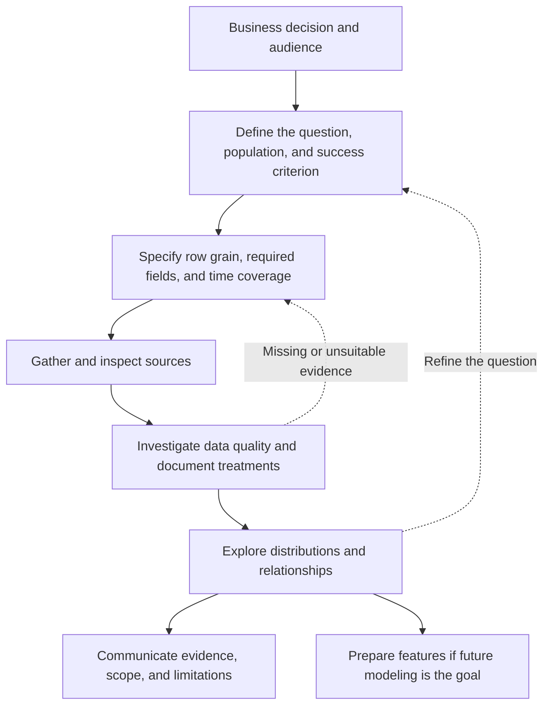
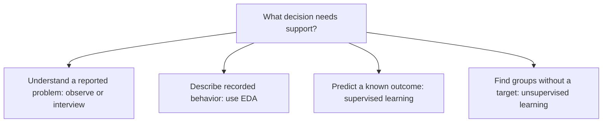
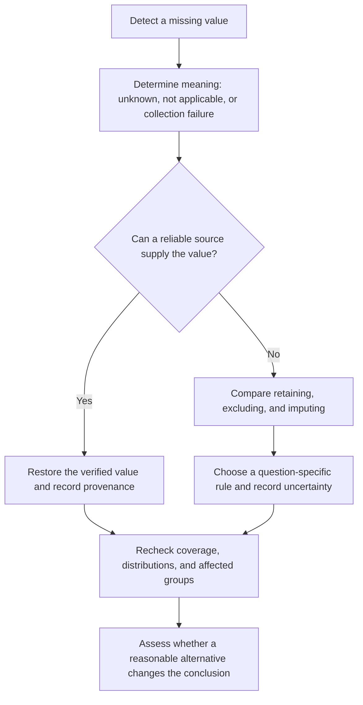
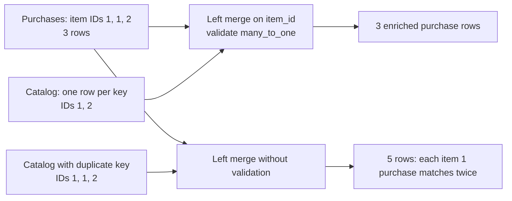
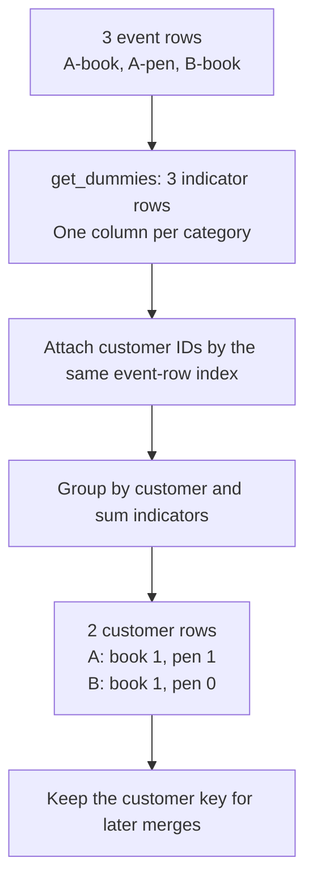

# Concepts: from a question to a trustworthy table

[Home](../README.md) · [Command reference](reference/pandas_numpy.md) ·
[Glossary](reference/glossary.md)

This guide explains the course's main ideas directly. The small datasets below
are included inline and do not require the lecture PDF, remote websites, or
course data files. Code blocks are independent examples, not assignment answers.
PDF page numbers are optional source notes only.

Mermaid diagrams provide visual summaries alongside the explanations. If your
Markdown viewer does not render Mermaid, the surrounding text carries the same
meaning; no diagram is required to run an example.

## 1. Scope the question before choosing operations

Data preparation is not simply “remove all errors.” A useful workflow is:

**Business question → data requirements → gathering → quality checks →
exploration → preparation for a particular next step.**

These stages are iterative: an unexpected pattern can reveal a source problem
or a poorly defined question.



The two endpoints serve different purposes: communicating an EDA finding does
not require training a model, and preparing features does not establish that a
model predicts well. Neither endpoint proves causation.

For example, “Why are customers leaving?” is too broad to determine a table.
First specify:

- **Audience and decision:** Who will use the result, and what can they change?
- **Population:** Which customers are eligible?
- **Outcome:** What counts as leaving, and over which time window?
- **Unit of analysis:** One customer, subscription, or customer-month per row?
- **Available evidence:** Which attributes and events were observed, and when?
- **Success criterion:** What finding or prediction would actually help?

Describing cancellation patterns is EDA. Predicting future cancellation is a
different task requiring a prediction cutoff, future outcome window, and
evaluation. Neither automatically establishes what causes cancellation.

### Choose an approach before collecting more data

Start with what the team can actually change. If customers report that
cancelling or renewing is confusing, observing a few people use the service
may reveal a process problem a model would not fix. If the team needs to know
when cancellations peak, start with descriptive analysis. Consider modeling
when its output would inform a concrete decision.



**Supervised learning** uses examples with a known target. To prioritize future
outreach, the team could learn from past customers whose later cancellation
status is known. **Unsupervised learning** looks for structure without a target
for the task. The team could group customers by listening behavior to explore
different usage patterns. Those groups are not predictions of who will cancel
and depend on how listening behavior is measured.

Start with the smallest population, time window, and set of sources that can
credibly support the decision. For example, an initial analysis of one renewal
cycle might help the outreach team decide what to investigate next, but it
cannot establish a seasonal pattern. Review the initial result with the people
who will use it, then expand the scope when it leaves an important question
unanswered.

*Optional lecture source: PDF pp. 7–40.*

## 2. Understand the table you loaded

A DataFrame is a table of labeled columns and rows. Each column is a Series.
Its **dtype** controls storage and permitted operations, but does not establish
meaning: customer IDs may be integers without being quantities to average.

```python
from io import StringIO
import pandas as pd

raw = StringIO("customer_id,amount\n101,12.50\n102,\n")
orders = pd.read_csv(raw)
print(orders.shape)          # (2, 2): rows, columns
print(orders.isna().sum())   # amount has one missing entry
```

`head()` previews the beginning, not a random sample. `info()` reports dtypes
and completeness; `describe()` summarizes selected columns and ignores missing
values in many calculations. Use several checks rather than trusting one.

A CSV is a text representation needing a delimiter/header interpretation.
An Excel workbook can contain multiple sheets with different grains. A SQLite
database contains tables queried through SQL; connecting is not the same as
loading a DataFrame. A successful read can still have the wrong delimiter,
sheet, date interpretation, or identifier type.

The source's structure tells you how much work is needed before you have a
table. **Structured** data, such as a database table, has defined fields.
**Semi-structured** data, such as JSON events, has named fields but can vary
between records or contain nested lists. Decide whether a row represents an
event or one item in its list before flattening it. **Unstructured** data, such
as free-text reviews, doesn't already have the fields you want to analyze:
you might need to extract a feature such as review length or topic first.

Relative paths are interpreted from the running process's working directory.
Changing the notebook's folder does not automatically repair a kernel already
running elsewhere. Check the working directory before changing filenames.

*Optional lecture source: PDF pp. 41–76.*

## 3. Cleaning means choosing and checking a rule

Separate **detection** from **treatment**. A null, duplicate, or extreme value
is evidence to investigate, not permission to apply a universal correction.

### Missing values

Unknown, not applicable, and genuine zero are different states.

```python
import pandas as pd

measurements = pd.Series([0.0, None, 8.0])
print(measurements.mean())              # 4.0: only two observed values
print(measurements.fillna(0).mean())    # about 2.67: a different assumption
```

Dropping observations changes the population; filling with a constant changes
the distribution. Mean imputation can reduce variability and distort
relationships. A categorical field may need an explicit unknown state rather
than a numeric replacement. Record why a treatment is justified and compare
results under a reasonable alternative.



This is a decision process, not an instruction to impute every unknown. An
observed zero is already a value; it should not enter this flow merely because
it looks inconvenient.

### Duplicates and outliers

Define a duplicate using the row grain. Two identical purchase records could
be duplicated ingestion or two legitimate purchases; repeated customer IDs
alone are expected in a transaction table.

An outlier can be a valid extreme, a unit mismatch, or an entry error.
Histograms, boxplot fences, and standard-deviation rules flag candidates;
they do not settle which interpretation is correct. The familiar three-SD
heuristic is oriented toward approximately normal distributions.

### Text, dates, and persistence

`.str` exposes elementwise text operations; `.dt` exposes datetime/timedelta
components. For example, stripping a currency symbol prepares text for numeric
conversion, but units and malformed tokens still need checking.

Many operations return a new object:

```python
import pandas as pd

labels = pd.Series([" Snack ", "Tea"])
trimmed = labels.str.strip()
# labels still contains the spaces; trimmed contains the cleaned strings.
```

Use explicit assignment when a change should persist. Keep raw input separate
from derived output so a cleaning rule can be audited or reversed.

*Optional lecture source: PDF pp. 77–131.*

## 4. Explore a stated population at a stated grain

Filtering changes which observations you describe. Sorting changes order, not
membership. Aggregation changes grain: transaction rows become one summary per
customer, category, or other group.

```python
import pandas as pd

events = pd.DataFrame({
    "customer": ["A", "A", "B"],
    "amount": [10.0, None, 5.0],
})
print(events.groupby("customer").size())           # A: 2 rows, B: 1 row
print(events.groupby("customer")["amount"].count()) # A: 1 known amount, B: 1
print(events.groupby("customer")["amount"].sum())   # A: 10.0, B: 5.0
```

`size`, `count`, `nunique`, and `sum` answer different questions. An average also
needs a defined denominator and coverage policy. Comparing countries with
different numbers of observed years, for example, is not automatically an
equally supported comparison.

Choose a chart to answer a question:

- **Histogram:** distribution of one numerical variable; bins affect appearance.
- **Boxplot:** compact distribution summary; marked extremes need investigation.
- **Bar chart:** compare defined summaries across categories.
- **Line plot:** change over an ordered dimension such as time.
- **Scatterplot/pairplot:** numerical relationships, clusters, and unusual points.

**Skew** is asymmetry, named for the longer tail, not where most observations
sit. Wait times of `2, 3, 3, 4, 18` minutes have a right tail: most waits are
short, but the 18-minute wait pulls the mean up to 6 minutes while the median
stays at 3. A left-skewed distribution has the longer tail on the low-value
side. Check the histogram and report the median alongside the mean when the
choice matters; a long tail alone doesn't make observations errors.

Label units and population. Correlation describes association, often linear;
it is not proof of causation, and a small correlation can hide nonlinear
structure. A popularity-filtered movie sample does not describe all movies.

*Optional lecture source: PDF pp. 132–162.*

## 5. Combine data without losing identity

**Concatenation** combines along an axis: `axis=0` stacks rows and aligns column
names; `axis=1` places columns side by side and aligns row-index labels.
**Merge** matches explicitly chosen key values.

```python
import pandas as pd

purchases = pd.DataFrame({"item_id": [1, 1, 2]})
catalog = pd.DataFrame({"item_id": [1, 2], "kind": ["book", "pen"]})
enriched = purchases.merge(
    catalog, on="item_id", how="left", validate="many_to_one"
)
assert len(enriched) == 3
```

The lookup must have at most one matching row per item for that invariant.
Duplicate lookup keys can multiply purchase rows and inflate later totals.
An inner join keeps matched keys, a left join keeps left-side records, and an
outer join retains both sides' keys. All can expand under duplicate matches.



In the lower branch, summing purchase amounts after the join can double-count
the item 1 purchases. Applying `validate="many_to_one"` to that duplicate-key
catalog rejects the merge instead of silently accepting the five rows.

An index is not automatically a business key. Series assignment and horizontal
concatenation commonly align index labels—even when the rows happen to be
different customers. Equal lengths do not prove correct identity. Preserve keys
through aggregation and merge on them when attaching customer-level features.

*Optional lecture source: PDF pp. 163–176.*

## 6. Build features with explicit intermediate shapes

Suppose each row is one event with a customer and category:

```python
import pandas as pd

history = pd.DataFrame({
    "customer": ["A", "A", "B"],
    "category": ["book", "pen", "book"],
})
flags = pd.get_dummies(history["category"])  # three event rows
with_ids = pd.concat([history["customer"], flags], axis=1)
counts = with_ids.groupby("customer").sum() # two customer rows
```

`flags` contains one indicator per category per event. Summing within a customer
turns indicators into counts: A has one book event and one pen event. These are
not necessarily quantities bought, unique products, or preference scores.



The grain changes only at the grouping step. Before it, a row is an event;
after it, a row is a customer. The diagram uses the same inline data as the
example, so the row counts can be checked directly.

For a share, numerator and denominator must count compatible units over the
same window. With zero total activity the ratio is undefined; decide how to
represent no history rather than pretending the preference was observed as 0%.

For recency, aggregate the last known event per customer, subtract it from a
fixed prediction cutoff, then extract elapsed days. A missing last event does
not mean the event happened today. Scaling and log transforms also change
representation, not data quality by themselves: zero denominators and
nonpositive log inputs need explicit handling.

Before future modeling, check:

1. One row per eligible prediction unit and a stable key
2. Target separated from features
3. Every feature available at the prediction cutoff
4. Valid joins, units, missingness policies, and finite derived values
5. Training-only fitting of preprocessing and appropriate held-out evaluation

A non-null numeric table is the course's teaching target, not proof of readiness
for every estimator. See [modeling preparation](reference/modeling_preparation.md)
for the training and timing boundary.

*Optional lecture source: PDF pp. 177–196.*
