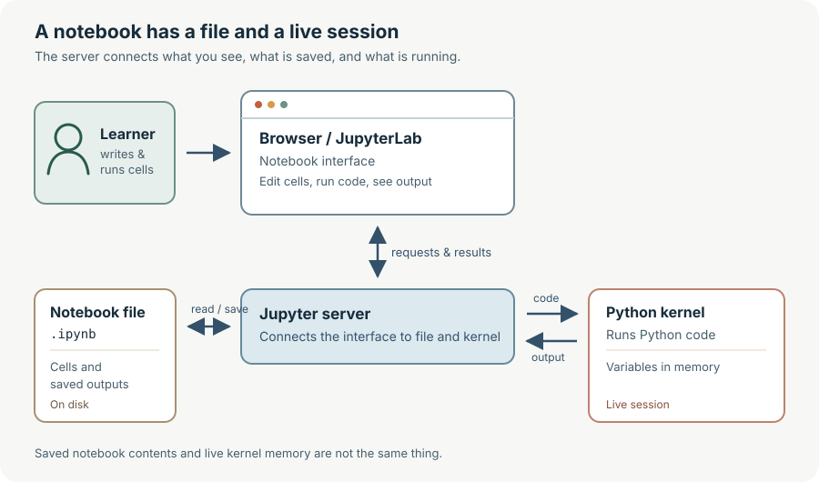

# 03 · Working in a Jupyter notebook

A notebook combines explanations, runnable code, and results in one document.
In this lesson, you'll see why a notebook can display an answer even when Python
no longer remembers how you got it. To install and launch JupyterLab, use the
[setup guide](../setup.md).

## What runs where?



| Part | What it does |
| --- | --- |
| **Browser interface** | Lets you edit cells, run them, and view their results. |
| **Jupyter server** | Serves the interface, handles notebook files, and relays messages between the browser and kernel. |
| **Notebook file (`.ipynb`)** | Stores cell contents and can store outputs from earlier runs. |
| **Kernel** | Runs Python and holds live variables and imports in memory. Restarting it resets that state, not the file. |

Cells run in the order you execute them, not necessarily the order you see them.
Python also resolves relative paths from the kernel's working directory. If a
file appears to be missing, check `Path.cwd()` (after `from pathlib import Path`)
before changing the path.

## Explain in Markdown, calculate in code

A **Markdown cell** explains the question, method, or result. For example,
`## Song count` renders as a heading and `**songs**` renders as **songs**.
A **Code cell** sends Python to the kernel. Inside it, a comment like
`# Count for one playlist` is a note for the reader, not an instruction to Python.

In **edit mode**, you're typing inside a cell. In **command mode**, you're
working with the cell itself: for example, selecting or moving it. Press
**Enter** on a selected cell to edit it, or **Esc** to return to command mode.
**Shift+Enter** runs the selected code cell or renders the Markdown cell.

## Try it: saved output versus live state

1. Create a Python notebook. In a Markdown cell, type `## Song count` and
   render it. Below it, add and run this Code cell:

   ```python
   songs = 3  # Count for one playlist
   ```

2. Add and run a separate Code cell. It should display `6`. Save the notebook.

   ```python
   print(songs * 2)
   ```

3. Choose **Kernel → Restart Kernel**, not an option that clears outputs or
   reruns cells. The previous `6` can still be visible. Predict what will
   happen if you now run only the `print` cell, then try it: it raises
   `NameError` because the new kernel has not run the assignment.
4. Run all cells from the top. The result is `6` again. Before sharing a
   notebook, restart the kernel and run all cells to check that the result
   doesn't depend on hidden state.

**Interrupt** asks the current kernel to stop a running cell. Variables already
created can remain, including changes made before the interruption. **Restart**
starts a fresh kernel and discards the live state.

*Optional source: Maven Analytics, Data Science in Python, Part 1, PDF pp. 41–61.*
