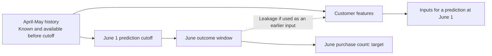

# Preparing a customer-level modeling table

[Reference index](README.md) · [Pandas/NumPy patterns](pandas_numpy.md) ·
[Glossary](glossary.md)

This is a worked bridge from EDA to the course's modeling-preparation notebooks,
not a model-training tutorial. It explains what the final table represents,
how to construct it, and why some choices matter. The final checklist supports
the walkthrough rather than replacing it.

## 1. Turn a business question into a table specification

Consider: **How many purchases will each eligible customer make in June?**

| Decision | Example specification | Why it matters |
|---|---|---|
| Decision user | A team planning customer outreach | Defines what a useful result would change |
| Population | Customers observed in April/May history | Defines who appears in the table; this is not every possible customer |
| Grain | One row per customer at the June 1 cutoff | Prevents mixing event rows with customer rows |
| Key | `customer_id` | Identifies the owner of each feature |
| Inputs/features (`X`) | April/May spend and activity counts | Information available before the prediction |
| Outcome/target (`y`) | Number of June purchases | A count, not automatically a yes/no label |
| Availability cutoff | Start of June 1 | Excludes later information from predictors |

The cohort rule is illustrative: a real customer registry could include people
with no April/May activity. Use the business population, not whichever join
happens to produce the fewest missing values.

## 2. Separate history from the outcome window



Read the solid time path as history → cutoff → future outcome. The dotted
backward path is a warning, not an allowed data dependency. A transaction's
event date alone is insufficient if the record was only available after the
cutoff. The target may use the future window; the predictors may not.

For churn, cancellation dates may define the outcome. Post-cancellation
listening activity or a subscription status updated after the cutoff cannot
be used as though it were known earlier. That is **leakage**: the model sees
information it would not have at prediction time.

## 3. Work through a tiny example

This independent example includes its data inline. It does not require the PDF
or course datasets and is not an answer to a course assignment.

```python
import pandas as pd

events = pd.DataFrame({
    "customer_id": ["A", "A", "B", "A", "C"],
    "date": ["2023-04-10", "2023-05-12", "2023-05-20",
             "2023-06-02", "2023-06-03"],
    "amount": [10.0, 20.0, 5.0, 7.0, 9.0],
})
events["date"] = pd.to_datetime(events["date"])
cutoff = pd.Timestamp("2023-06-01")
horizon_end = pd.Timestamp("2023-07-01")

# The example assumes complete April-June capture and one row per purchase.
history = events.loc[
    (events["date"] >= "2023-04-01") & (events["date"] < cutoff)
].copy()
future = events.loc[
    (events["date"] >= cutoff) & (events["date"] < horizon_end)
].copy()

features = history.groupby("customer_id").agg(
    total_spend=("amount", "sum"),
    purchase_rows=("date", "size"),
    last_purchase=("date", "max"),
).reset_index()
features["recency_days"] = (cutoff - features["last_purchase"]).dt.days
target = future.groupby("customer_id").size().rename("june_purchases")

table = features.merge(
    target.reset_index(), on="customer_id", how="left", validate="one_to_one"
)
# Only the missing outcome is filled: complete future coverage is assumed.
table["june_purchases"] = table["june_purchases"].fillna(0).astype(int)
assert table["customer_id"].is_unique
assert len(table) == 2
assert table.set_index("customer_id")["june_purchases"].to_dict() == {"A": 1, "B": 0}
```

### Read the intermediate tables

| Stage | Grain | Rows | Meaning |
|---|---|---:|---|
| `events` | Purchase event | 5 | Includes both history and outcomes |
| `history` | Purchase event | 3 | Only April/May events |
| `features` | Customer | 2 | A and B, each summarized once |
| `target` | Customer with a June event | 2 | A and C |
| `table` | Eligible historical customer | 2 | A and B, with outcomes attached |

Customer C is not eligible under this example's historical cohort rule, so
does not appear in `table`. B's zero means no June event **under the complete
coverage assumption**, not merely “a join produced a null.”

The result has A's historical spend of 30 and B's of 5. Their recencies are
20 and 12 days. June spend never enters those features.

## 4. Add features without changing row ownership

Common feature families have different meanings:

| Feature | Construction | Interpretation to check |
|---|---|---|
| Frequency | Count historical purchase rows | Events, not necessarily unique products |
| Monetary value | Sum historical amounts | Consistent currency and transaction grain |
| Recency | Cutoff minus last known purchase | Missing history is not zero days |
| Category counts | Dummy indicators, then customer-level sums | Counts, not automatically preferences |
| Category shares | Category count / compatible total | Same grain/window; zero denominator is undefined |
| Customer attributes | Join from a customer lookup | One lookup row per key and availability at cutoff |

`get_dummies()` creates indicators at its input grain. After grouping and
summing, those indicators become counts. For text categories, arbitrary integer
codes can introduce an order that has no business meaning.

Always attach aggregates by a key. A Series indexed `0, 1, 2` is not keyed by
customer merely because another table also has three rows. pandas alignment
can silently give a plausible shape with the wrong feature owners.

## 5. Choose representation for the next task

The course targets a numeric, non-null table. That is an exercise interface,
not a universal requirement for every estimator.

- Keep IDs for joins and audit, but do not automatically treat them as numerical
  predictors.
- Retain a separate target; `X` must not include the outcome or a disguised copy.
- A log transform requires positive inputs; it does not guarantee normality.
- Scaling changes units/range, not the underlying evidence. Constant columns
  need a zero-denominator policy.
- A missing discount status is not a confirmed “no.” Preserve uncertainty or
  state the assumption behind a replacement.

## 6. The next course: fitting and evaluation

Before fitting an ML model, separate training data from evaluation data.
Learn imputation values, scaling parameters, category vocabularies, and feature
selection from training data only, then reuse them on held-out data.

Use a split matching the future use case. Random rows can be misleading for
time-dependent outcomes or repeated observations of the same customer.
Exploratory correlations do not measure predictive performance, and
discount–cancellation associations do not show that discounts cause churn.

## Final table review

1. Can you state the population, grain, key, cutoff, and outcome window?
2. Does every feature belong to the correct customer?
3. Did joins preserve expected cardinality and expose unmatched records?
4. Were features actually available at the cutoff?
5. Are missingness, valid ranges, units, and zero denominators explained?
6. Can you distinguish a checked preparation table from an evaluated model?

Optional source note: lecture PDF pp. 163–196. Training/evaluation guidance
extends the preparation lesson; it is not a claim that the course trains models.
